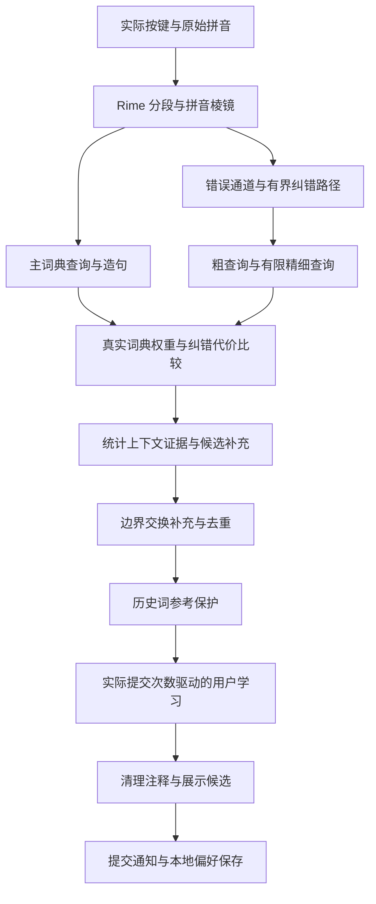

# 探索过程与当前技术架构

本文维护经过验证的设计结论，不收录原始探索记录、逐轮跑分、日志、测试输入或个人词库。代码变化涉及架构或主要结论时，同步更新本文。

## 项目目标与公开版边界

在 Rime 的拼音译码能力之上，增加有限成本的纠错搜索和候选排序。优先处理 in/ing、en/eng、邻键、漏键及相邻交换，保持原始输入可见。

公开版提取通用纠错算法和学习机制，词库由安装器从固定版本的上游白霜下载。个人领域词库、手工提高的词频、自定义短语和已有学习记录不随项目发布。学习机制的代码与使用者运行后生成的数据是两回事；数据仅留在使用者的 Rime 用户目录。

本地稳定版本使用的领域词库、模型与公开版默认配置存在差异，因此本地准确率和延迟不能直接作为公开版的性能承诺。MSVC 构建、修改原生插件的实验及 Windows 专用 Shift 守护程序不包含在公开版中。

## 探索过程

| 阶段 | 研究内容 | 留下的结论 |
| --- | --- | --- |
| 初始纠错搜索 | 使用多个原生翻译器生成原拼音、鼻音、漏键等候选 | Rime 继续负责词典查找与造句，Lua 负责搜索调度与合并，避免另写一套中文译码器 |
| 查询成本优化 | 查询去重、缓存、限制候选枚举及不同同音词预算 | 调用次数减少不保证耗时降低；昂贵的长拼音查询可能仍被保留。单次小幅收益必须独立复测 |
| 错误通道与预算 | 给错误路径设置先验、按证据限制精细查询 | 从均匀扩展转为有预算的搜索；保留正确拼音候选，结合真实词典权重比较纠错候选 |
| 上下文排序 | 使用已有统计语言模型，必要时引入另一模型的候选 | 上下文只在证据足够强时推动替代候选，避免无条件替换首选。没有引入神经网络 |
| 用户学习 | 区分历史标记与实际提交次数 | 星号不构成优先理由；通过实际提交累积偏好，缓慢衰减，并用通用词典参考抑制偶然历史词抢首选 |
| 成本剖析 | 区分查询、迭代、Lua 桥接与垃圾回收 | 一部分成本来自 LuaTranslation 生命周期所触发的回收；触发位置不等于垃圾产生位置，不能靠关闭 GC 证明优化 |
| GC 策略验证 | 隔离比较原策略、调度实验与 Lua 生成式回收 | 本地稳定配置采用 Lua 5.4 生成式 GC，算法仍沿用既有 Lua 链路。公开版将其作为可选项，避免对未知前端作跨版本承诺 |

查询缓存只复用适用范围内的结果，不能把活跃的原生 Translation 迭代器跨按键长期保存。轻量索引与 C++ 原生化曾被考虑，当前公开架构仍以 Lua 为主；没有声称已完成整个热路径的 C++ 迁移。

## 当前候选流水线

### 查询与错误通道

主译码器、纠错译码器及只读参考译码器均由 `Component.Translator` 创建。它们共用通用词典，但可使用不同拼音棱镜、同音词数量和句子预算。

错误通道描述 QWERTY 邻键、漏键、交换和鼻音变化的相对可能性。搜索负责生成与筛选路径；原生 `script_translator` 负责词典查询和造句。评分优先使用原始 phrase/sentence 权重，不把展示层的 quality 偏移误当成词频。

### 上下文与模型

默认通过 Octagram 使用轻量统计模型；可选配置万象模型。只读模型模块可以为局部候选比较提供词组证据，缺少或不兼容的可选模型时放弃该证据。它不是训练器，也不是神经推理服务。

### 学习与显示

用户提交候选后，学习模块记录拼音、词语、计数和更新时间。偏好半衰期为五年。历史参考过滤器与学习排序先后工作，避免仅因原生历史标记就获得首选，同时让持续选择逐渐形成偏好。

正确拼音不显示纠错标记，真实纠错只显示一个 `≈`，预编辑保留用户实际输入。公开版不包含私人词语特例，也不导入发布者的学习状态。

### 回收与兼容性

通用代码需要 Lua 5.3 或更新版本；生成式 GC 需要 Lua 5.4。可选初始化组件只在显式配置后尝试开启生成式回收，失败时保留原策略。不会关闭 GC 或把 Lua 状态交给后台线程回收。

GC 策略作用于共享 Lua 状态；即使只在本方案初始化时设置，也可能影响同一进程中的其他 Lua 组件。关闭此选项后应重启输入法进程，不能把切换方案视为回退。

## 验证原则与后续方向

速度比较固定词库、模型、输入集合和两个对照版本。延迟单进程交错测量，准确率可以并行；保留失败复测，不能挑最好的一轮。计时探针用于定位成本，撤除探针后才验收性能。

架构改造应核对候选文本、顺序、注释与预编辑，连续输入检查内存和生命周期。P50、平均值反映常态，P95、P99 和超时比例反映长尾；单个 Max 不能独立说明稳定性。

后续优先区分稳定的长查询与偶发 GC／调度尖峰。原生化应针对不必要的包装对象和桥接成本，先建立最小对照，再决定是否迁移完整纠错热路径。
