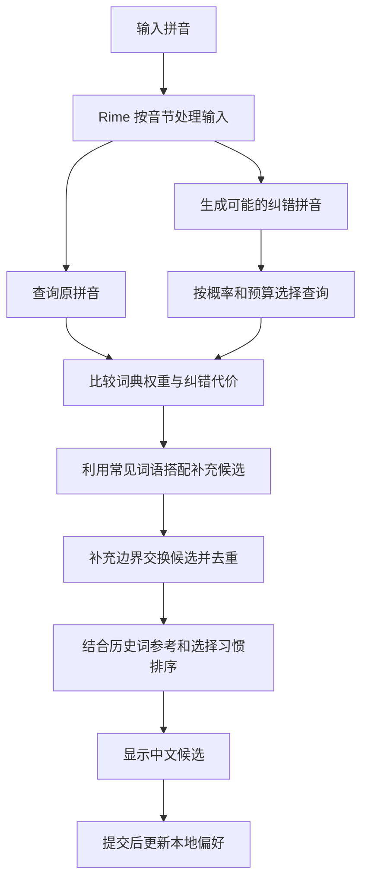

# 探索过程与技术架构

本方案沿用 Rime 的词典查找与组句能力，在外层增加纠错搜索、候选排序和输入习惯学习。这篇文档概述设计如何演进，并介绍现在的工作方式。

## 先认识几个词

| 名称 | 在这里的意思 |
| --- | --- |
| Rime | 输入法引擎，负责把拼音转换为中文候选 |
| 白霜 | 提供常用字词和基础配置的开源项目 |
| Lua | 实现本方案纠错调度与排序逻辑的脚本语言 |
| 译码器 | 根据拼音查找词语、组合句子的组件 |
| 语言模型 | 根据常见词语搭配帮助判断候选是否自然 |
| 错误通道 | 描述字母可能怎样输错，以及各种错误的相对可能性 |
| 查询预算 | 每次按键允许探索多少条纠错路径、读取多少个候选 |
| GC | 清理暂时不用的数据所占内存的机制 |

## 探索过程

| 阶段 | 尝试解决的问题 | 主要结论 |
| --- | --- | --- |
| 初始纠错搜索 | 拼音输错后，怎样找到可能想输入的词 | 查询原拼音以及几类修复后的拼音，再比较候选 |
| 查询成本优化 | 探索多条路径造成额外等待 | 去重、缓存和限制候选数量有帮助，但查询少了不一定更快：长拼音查询本身可能更贵 |
| 错误通道与预算 | 怎样把查询优先用在更可能的修复上 | 为鼻音、邻键、漏键和交换设置相对概率，再限制精细查询的数量 |
| 上下文排序 | 多个候选都能成立时，怎样选更自然的一个 | 使用统计语言模型的词组证据，证据充分时才提升替代候选 |
| 用户学习 | 怎样让经常使用的词更容易选到 | 根据实际提交次数积累偏好，结合通用词典参考，减少偶然历史词占据首选 |
| 成本剖析 | 延迟到底花在查询、脚本还是内存清理上 | 需要分开测量；对象销毁时触发的 GC 可能在清理之前产生的数据 |
| GC 策略验证 | 能否通过改变回收方式减少等待 | Lua 5.4 生成式 GC 值得尝试，当前作为可选设置提供 |

当前实现以 Lua 调度 Rime 原生组件为主。后续是否迁移更多逻辑到 C++，取决于对具体瓶颈的测量与最小原型结果。

## 从按键到候选

例如输入 `jintain`，搜索模块会尝试相邻字母交换得到 `jintian`。Rime 查询对应词语，排序模块再比较原输入与修复输入的候选。纠错候选显示 `≈`，输入栏保留实际字母。

## 各部分怎样分工

### 1. 词库查找与纠错搜索

主查询处理原始拼音，纠错查询处理修复后的路径，参考查询帮助判断历史词是否应占据首选。它们共用白霜通用词库，可以使用不同的拼音规则和候选数量限制。

错误通道根据 QWERTY 键盘位置和音节规则生成修复。主要考虑附近按键误触、漏字母、相邻交换和 `in/ing`、`en/eng` 混淆。候选比较使用原始词典权重，再结合纠错代价。

代码中的 `Component.Translator` 用来创建这些 Rime 查询组件，`script_translator` 承担实际查词和组句工作。

### 2. 上下文判断

默认使用 Octagram 和轻量的 `zh-moqi` 统计模型。启用可选万象模型后，还可以读取词组证据进行局部候选对比。可选模型文件缺失或不兼容时，跳过这部分证据。

上下文排序采用较强证据才提升替代候选，减少把正常输入改成另一个意思的机会。

### 3. 用户习惯学习

历史参考模块先减少偶然历史词抢首选的情况，学习模块再根据明确的实际选择积累偏好。记录包含拼音、词语、计数和更新时间，保存在使用者的 Rime 用户目录。

偏好采用五年半衰期缓慢衰减。提升范围限于当前已有候选，保证词语仍有查询依据。

### 4. 内存回收

Lua 会产生临时对象，GC 负责回收它们。回收频率和时机会影响延迟，因此需要与词典查询分开观察。

通用逻辑需要 Lua 5.3 或更新版本，可选生成式 GC 需要 Lua 5.4。该选项作用于同一进程中的 Lua 状态，关闭后应重新部署并重启输入法，详见[设置说明](CONFIGURATION.md#开启生成式-gc进阶)。

## 后续关注的方向

首先区分两种慢：某些长拼音本身查询就贵，以及 GC 或系统调度造成的偶发停顿。前者适合改进查询路径和预算，后者需要观察回收时机与系统负载。

缓存也要考虑数据有效期。词典、上下文和候选对象的生命周期会变化，活跃的查询迭代器不能简单长期保存。原生化探索应优先针对重复包装与跨语言调用的成本，先验证小范围原型。

改进期间同时检查速度与候选质量。有关计时指标和复测方法，见[验证文档](VALIDATION.md#怎样比较速度)。架构或主要结论变化时，同步更新本文。
